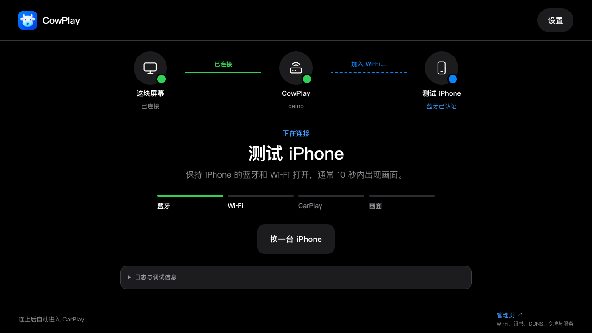
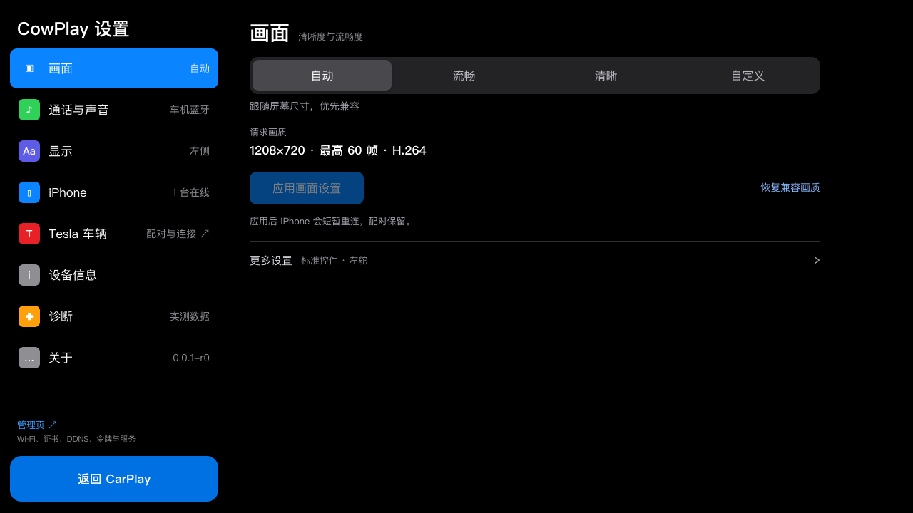
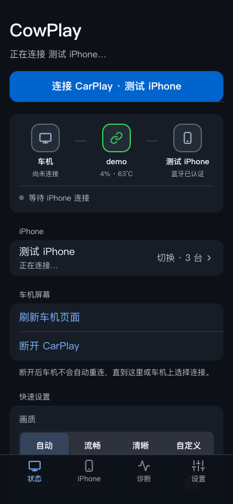

<p align="center">
  
</p>

# CowPlay

**把无线 CarPlay 带到车机浏览器。**

CowPlay 在独立接收端运行，通过无线连接接收 iPhone 画面，让车机浏览器成为 CarPlay 的显示与触控入口。打开网页、连接手机，即可使用熟悉的 CarPlay 界面。

主要面向中兴 F50 / MU300 OpenWrt，也提供 Linux x86_64 和 ARM64 安装包。

> **开发预发布**：当前版本用于测试与反馈，尚未达到正式版验收标准。[下载预发布](https://github.com/helloworlde/cowplay/releases) · [支持范围与验证边界](docs/STATUS.md)

## 核心能力

- **无线 CarPlay**：蓝牙配对后通过 Wi-Fi 传送画面，浏览器负责显示与触控回传。
- **手机管理**：保存多部 iPhone 的独立配对，连接、切换、断开；一次使用一部手机。
- **画面设置**：按屏幕调整分辨率、帧率、布局和外观，提供断线后的恢复入口。
- **设备管理**：车机与手机页面配合后台管理，处理访问授权、证书、状态和脱敏诊断。
- **Tesla 与 CarPlay Ultra**：车辆状态接入原生 Ultra 通道，提供受授权的空调控制。
- **签名更新**：开发版与正式版使用独立渠道，安装前验证签名、架构及状态格式，保留配置与配对。

## Tesla 与 CarPlay Ultra

通过 Tesla BLE 读取电量、额定续航、四轮胎压和空调状态，并将车辆数据提供给 CarPlay Ultra 原生界面。未连接、缺失或过期的读数保持未知。

当前车辆控制范围为**空调开关与双区温度**。只读监控和车辆控制分别授权；控制需要车主独立授权，并在本次 CarPlay 会话中明确允许。Ultra、实车兼容和控制效果仍处于开发验证阶段，详见 [项目状态](docs/STATUS.md)。

## 界面

**连接状态**：从网页连接到手机认证、Wi-Fi、CarPlay 和画面，逐步显示进度。



**画面与手机管理**：车机上调整画面，手机上管理连接。

<p>
  
  
</p>

*以上为 CowPlay 实际网页界面，使用合成演示数据；不是实车或真实 CarPlay 媒体验收截图。*

## 安装

从 [Releases](https://github.com/helloworlde/cowplay/releases) 选择平台与渠道。当前开发包标为 **Pre-release**；正式渠道不会自动采用开发版。

| 平台 | 安装材料 | 指南 |
| --- | --- | --- |
| F50 / MU300 OpenWrt | 同版本的 `cowplay` 与 `luci-app-cowplay` 两个 APK | [安装与配置](docs/INSTALL-OPENWRT.md) |
| Linux x86_64 | `cowplay-…-linux-x86_64.tar.gz` | [Linux 安装](docs/LINUX.md) |
| Linux ARM64 / 64 位树莓派 | `cowplay-…-linux-arm64.tar.gz` | [Linux 安装](docs/LINUX.md) |

安装前核对发布公钥指纹、签名和 SHA-256。接收端需要蓝牙、已配置的 Wi-Fi 热点、可信 HTTPS 证书，以及使用者合法持有的配件身份。项目不附带私人身份、配对资料或厂商固件。

### 下载与验签（两平台通用）

需要 `wget`、OpenSSL 和 `sha256sum`。以下安装首个开发预发布 `v0.0.1`，先在新建临时目录下载并核验：

```sh
set -eu
umask 077
work=$(mktemp -d)
cd "$work"
version=0.0.1-r0
base=https://github.com/helloworlde/cowplay/releases/download/v0.0.1
for file in release-key.pem SHA256SUMS SHA256SUMS.sig; do
  wget -O "$file" "$base/$file"
done
printf '%s  release-key.pem\n' '5f926239adc2029a33ed58c6e7e2107dcc424fb7e8133cdbdcb777e5f1a8b40f' | sha256sum -c -
openssl dgst -sha256 -verify release-key.pem -signature SHA256SUMS.sig SHA256SUMS
```

### OpenWrt / F50

以管理员身份完成上述验签，再下载并安装同版本双包。发布公钥放入 APK 信任目录；[安装指南](docs/INSTALL-OPENWRT.md)包含配置与 LuCI 入口。

```sh
core=cowplay-$version-aarch64_generic.apk
luci=luci-app-cowplay-$version-noarch.apk
wget -O "$core" "$base/$core"
wget -O "$luci" "$base/$luci"
awk -v a="$core" -v b="$luci" '
  NF != 2 || length($1) != 64 || $1 ~ /[^0-9a-f]/ { bad=1 }
  $2 == a { if (first++) bad=1; print }
  $2 == b { if (second++) bad=1; print }
  END { if (bad || first != 1 || second != 1) exit 1 }
' SHA256SUMS > APK-SHA256SUMS
sha256sum -c APK-SHA256SUMS
apk --keys-dir . verify "./$core" "./$luci"
mkdir -p /etc/apk/keys
cp release-key.pem /etc/apk/keys/cowplay-release.pem
apk add "./$core" "./$luci"
cowplay update-bootstrap
mkdir -p /etc/cowplay/state
chmod 700 /etc/cowplay/state
cowplay init-access /etc/cowplay/state
```

`init-access` 仅在全新安装时执行一次，拒绝覆盖已有访问状态。随后按指南配置身份、热点和 HTTPS，再启动服务。

### Linux x86_64 / ARM64

完成上述验签后，选择当前主机架构并安装。安装器不自动启用或启动服务；运行配置见 [Linux 指南](docs/LINUX.md)。

```sh
case "$(uname -m)" in
  x86_64) arch=x86_64 ;;
  aarch64|arm64) arch=arm64 ;;
  *) echo 'Unsupported architecture' >&2; exit 1 ;;
esac
file=cowplay-$version-linux-$arch.tar.gz
wget -O "$file" "$base/$file"
awk -v name="$file" '
  NF != 2 || length($1) != 64 || $1 ~ /[^0-9a-f]/ { bad=1 }
  $2 == name { if (found++) bad=1; print }
  END { if (bad || found != 1) exit 1 }
' SHA256SUMS > LINUX-SHA256SUMS
sha256sum -c LINUX-SHA256SUMS
tar -xzf "$file"
cd "cowplay-$version-linux-$arch"
sudo sh ./install.sh
```

## 开始使用

1. 按平台指南安装并完成配置，启动 CowPlay。
2. 在车机打开 CowPlay 地址，按首次使用提示设置访问方式。
3. 在手机打开 `/pairing`，配对 iPhone，核对两端配对码，然后连接 CarPlay。

车机入口为 `/`，手机入口为 `/pairing`。已保存手机可直接选择连接；取消或断开保留配对。[设备管理与更新](docs/RELEASES.md)说明正式／开发渠道选择、签名验证及失败恢复。

## 当前边界

F50 是主要适配目标；Linux／树莓派的完整无线链路仍待验收。真实音频、双手机切换、Ultra／车辆控制和长期稳定性仍在验证，详见 [项目状态](docs/STATUS.md)。F50 不支持有线 CarPlay。

## 开发

Rust workspace 与 TypeScript/Vite 使用锁定依赖。先构建网页，再编译接收端：

```sh
npm ci --prefix web
npm run build --prefix web
cargo build --release --locked
cargo test --workspace --locked
```

`make help` 列出打包和回归入口。[架构](docs/ARCHITECTURE.md) · [构建、签名与发布](docs/RELEASES.md) · [网络与证书](docs/NETWORK.md)

## 许可与致谢

GPL-3.0-only，见 [LICENSE](LICENSE) 和 [NOTICE.md](NOTICE.md)。

Based on LIVI by Lasse Heitgres (https://github.com/f-io/LIVI).
