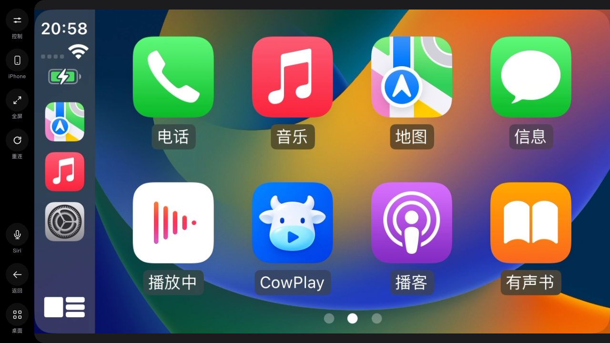

# CowPlay

## 核心功能截图



## 项目介绍

CowPlay 将 iPhone 的无线 CarPlay 带到车机浏览器，支持触控、画面设置和多手机管理。接收端支持中兴 F50 / MU300 OpenWrt、Linux x86_64 和 ARM64（含 64 位树莓派）。

当前为开发预发布。Tesla BLE 与 CarPlay Ultra 为实验功能；音频、双手机切换、真实车机和长期稳定性仍需[现场验收](docs/STATUS.md)。

## 安装

### F50 / MU300 OpenWrt

适用 **OpenWrt 25.12.6、aarch64_generic、厂商 5.4 内核**。标准软件源索引已加入构建，尚未发布；当前私有仓库不能匿名安装。以下命令在软件源公开后，以 root 安装最新开发预发布：

```sh
repo="https://github.com/helloworlde/cowplay/releases/download/$(wget -qO- https://api.github.com/repos/helloworlde/cowplay/releases | jsonfilter -e '@[@.prerelease=true].tag_name' | head -n 1)"
wget -O /etc/apk/keys/cowplay-release.pem "$repo/release-key.pem" &&
apk add --repository "$repo/packages.adb" cowplay luci-app-cowplay
```

**MU300 蓝牙随 CowPlay 自动初始化。** 包内自带私有 BlueZ/D-Bus，复用固件的 `sprdbt_tty`、`mu300-bt-init` 和蓝牙固件；无需另装 `bluez-daemon`，不要安装官方 6.12 内核模块。

安装后进入 LuCI「服务 → CowPlay」，按[首次配置说明](docs/INSTALL-OPENWRT.md)准备合法配件身份、已有热点和可信 HTTPS 证书，再启动服务。升级使用 LuCI 更新入口，保留配置与配对。

### Linux / 64 位树莓派

下载并验证对应架构的 [Release](https://github.com/helloworlde/cowplay/releases) 归档，解压后运行 `sudo sh ./install.sh`。系统 BlueZ、热点及首次配置见 [Linux 安装说明](docs/LINUX.md)。

## 开发

需要 Rust、Node.js 24 和 npm；在源码根目录执行：

```sh
npm ci --prefix web
npm run build --prefix web
cargo build --release --locked
cargo test --workspace --locked
```

构建 F50 APK：`make init && make build`（另需 Docker/OrbStack、Python 3）。[架构说明](docs/ARCHITECTURE.md) · `make help`

## License

[GPL-3.0-only](LICENSE)。第三方来源与许可见 [NOTICE.md](NOTICE.md)。

Based on LIVI by Lasse Heitgres (https://github.com/f-io/LIVI).
